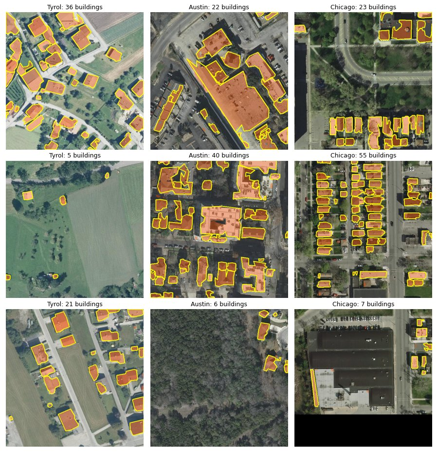
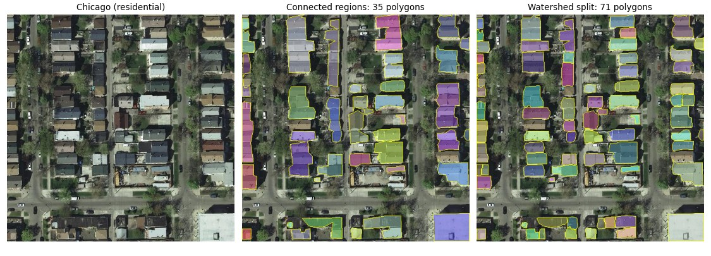
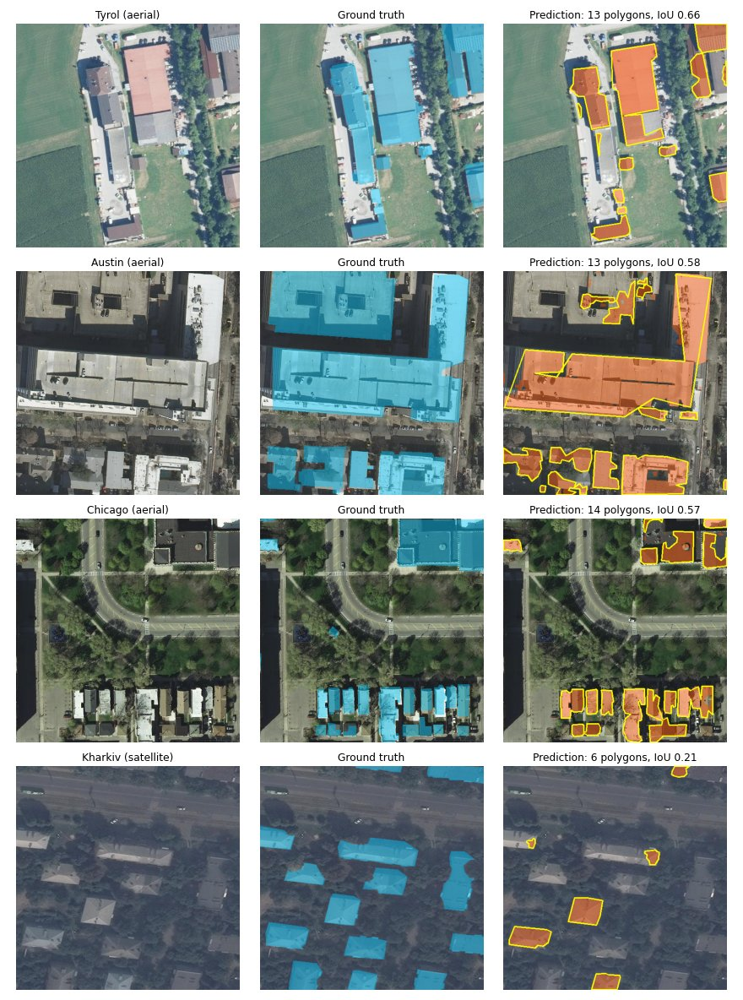
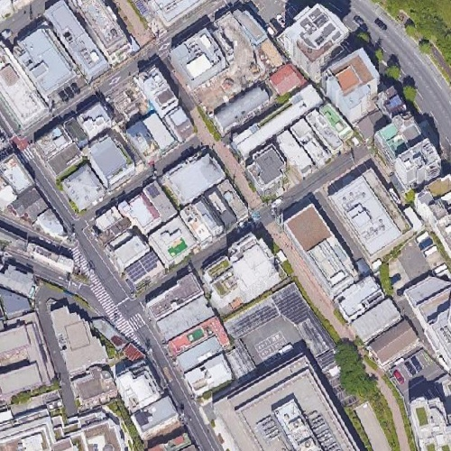
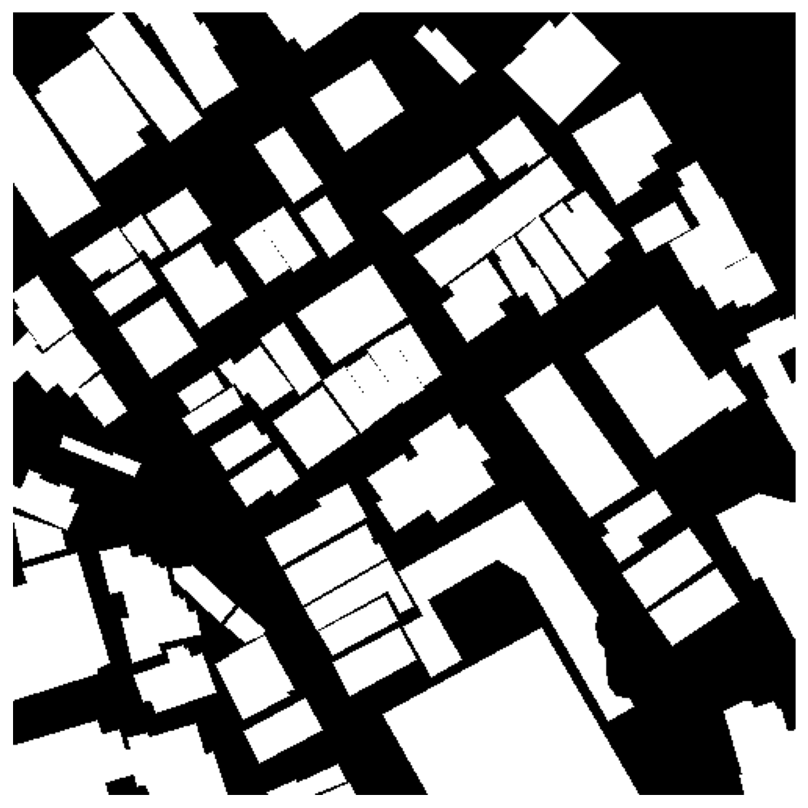

# Building Extraction from Aerial Imagery

[](https://colab.research.google.com/github/sequeiradiogo/Building-data-extraction/blob/main/notebooks/inference_demo.ipynb)

[](LICENSE)

Detecting building footprints in aerial images and exporting them as polygons, built for the
[IEEE BigData Cup 2024 – Building Extraction Generalization Challenge](https://www.kaggle.com/competitions/building-extraction-generalization-2024) on Kaggle.

A U-Net with an ImageNet-pretrained ResNet-34 encoder predicts a building probability map; a
**seeded watershed** then separates touching buildings, and each building is exported as a simplified
polygon. Adding the watershed step raised the leaderboard score from **0.262 to 0.401** (private F1)
without retraining the model.


<sub>Predictions on the 9 sample images from the competition test set in `output/examples/test_images.zip`
(no ground truth is available for them). Orange: predicted mask, yellow: one exported polygon per
building. Note the false positive along the right edge of `0046.tif`.</sub>

---

## Pipeline

```
COCO polygons ──► prepare_dataset.py ──► binary masks (PNG)
                                              │
                                              ▼
                      train.py: U-Net / ResNet-34, BCE + Dice loss, AdamW + OneCycleLR, AMP
                                              │
                                              ▼
test images ──► predict.py: probabilities ► mask + clean-up ► watershed split ► polygons ──► submission.csv
```

| Component | Choice |
|---|---|
| Architecture | U-Net, ResNet-34 encoder (ImageNet weights), 24.4 M parameters ([segmentation_models_pytorch](https://github.com/qubvel-org/segmentation_models.pytorch)) |
| Input | 512 × 512, ImageNet normalization |
| Augmentation | flips, 90° rotations, small rotations, brightness/contrast, blur/noise ([Albumentations](https://albumentations.ai)) |
| Loss | 0.3 · BCE + 0.7 · Dice (Dice weighted higher to favour overlap with the building mask) |
| Optimization | AdamW, OneCycleLR (peak 1e-3), mixed precision, early stopping on validation IoU |
| Post-processing | threshold 0.5, morphological close + open, seeded watershed (seeds: probability > 0.9, eroded 4 px), polygons with area ≥ 100 px, Douglas–Peucker simplification (ε = 1 % of the perimeter) |

A simpler **baseline** (`train_baseline.py`) is included for comparison: a 3-level U-Net trained from
scratch with an equally weighted BCE + Dice loss. Its original results were lower than the final
model's, but they were affected by a bug (the geometric augmentations were applied to the images but not to
the masks) that has since been fixed, so they are not reported here.

## Results

| Post-processing | Pixel IoU (val) | Building F1 (val) | Kaggle public | Kaggle private |
|---|---|---|---|---|
| Connected regions (original) | 0.783 | 0.41 | 0.259 | 0.262 |
| **+ watershed split** | 0.783 | **0.65** | **0.383** | **0.401** |

*Pixel IoU*: mean per image, the metric used during training (pixel Dice 0.873).
*Building F1*: a predicted polygon counts as correct when it overlaps an annotated building with
IoU > 0.5, computed with [`src/evaluate.py`](src/evaluate.py) on the 933 validation images. The winning
solution of the challenge reached 0.703 (private) with an instance-segmentation model (YOLOv8-seg).

### From pixels to buildings

The model scored well on pixels (IoU 0.78), but the first submission only reached 0.26. The
leaderboard scores **buildings**, and semantic segmentation cannot tell touching buildings apart: a row
of houses came out as a single polygon. On the validation set the original pipeline produced only
17 k polygons for 38 k annotated buildings (recall 0.30).

The fix is a post-processing step, without retraining. The model is very confident in the centre of each
building and less so on the gaps between neighbours. The high-confidence cores (probability > 0.9, eroded by
4 px) become seeds, and a watershed on the probability map grows each seed until it meets its neighbour,
cutting the merged regions along those gaps. The parameters were chosen on the validation set with
`evaluate.py`; the threshold, minimum area and simplification were already close to optimal.



The gap between validation (0.65) and the leaderboard (0.40) most likely comes from the test images,
which cover different regions than the training data. That domain shift is what the challenge is about.

### Generalization to other imagery

To check how the model behaves outside the competition data, it was evaluated, without any
fine-tuning, on the 967 test images of the
[Roboflow *Buildings Instance Segmentation* dataset](https://huggingface.co/datasets/keremberke/satellite-building-segmentation) (CC BY 4.0):

| Imagery | Images | Pixel IoU | Pixel F1 |
|---|---|---|---|
| Aerial (Tyrol, Austin, Chicago) | 400 | 0.68 | 0.77 |
| Other sources, mostly satellite (Kherson, Tripoli, Donetsk, Mekele, Mykolaiv, Kharkiv, …) | 567 | 0.23 | 0.31 |
| **All** | 967 | 0.42 | 0.50 |


<sub>One randomly picked image per region. Orange: predicted mask, yellow: exported polygons, blue: ground truth.</sub>

The model transfers reasonably well to other **aerial** imagery but degrades strongly on **satellite**
images, which look quite different from the training data (see the Kharkiv example). This is the
same domain-shift problem that the "generalization" theme of the challenge is about.

## Repository structure

```
├── src/
│   ├── prepare_dataset.py   # COCO polygons -> image / binary mask pairs
│   ├── dataset.py           # PyTorch datasets + joint image/mask augmentation
│   ├── train.py             # final model (U-Net / ResNet-34)
│   ├── train_baseline.py    # baseline U-Net from scratch
│   ├── predict.py           # inference, watershed split, polygons, submission CSV
│   ├── evaluate.py          # per-building F1 on a COCO-annotated split
│   ├── engine.py            # losses, metrics, train / validation loops
│   └── common.py            # checkpoints, model construction, figures
├── notebooks/
│   └── inference_demo.ipynb # inference demo (runs on CPU)
├── data/instructions.md     # where to get the dataset
├── assets/                  # README figures and sample images from another dataset
├── models/                  # model weights (downloaded, not tracked)
├── output/
│   ├── submission.csv       # submitted predictions (private F1 0.401)
│   └── examples/            # example image/mask and 9 competition test images
└── requirements.txt
```

## Getting started

### Quick demo
Open [`notebooks/inference_demo.ipynb`](notebooks/inference_demo.ipynb) in Colab with the badge at the
top. It downloads the trained weights and runs on sample competition images; no dataset is needed.

### Installation
```bash
git clone https://github.com/sequeiradiogo/Building-data-extraction.git
cd Building-data-extraction
pip install -r requirements.txt
```

### Pre-trained weights
Download `unet_resnet34_buildings.pth` (98 MB) from the
[latest release](https://github.com/sequeiradiogo/Building-data-extraction/releases/latest) into `models/`:

```bash
mkdir -p models
curl -L -o models/unet_resnet34_buildings.pth \
  https://github.com/sequeiradiogo/Building-data-extraction/releases/download/v1.0/unet_resnet34_buildings.pth
```

SHA-256: `543215f09324e38a52be0c735a931c46ec415ea5836eda064f3bc8767d725093`

### Data
Download the data from the [competition page](https://www.kaggle.com/competitions/building-extraction-generalization-2024/data)
(see [`data/instructions.md`](data/instructions.md)) and arrange it as:

```
raw/
├── train/  train.json  image/*.jpg
├── val/    val.json    image/*.jpg
└── test/   *.tif   (or image/*.tif)
```

Then convert the COCO annotations into masks:

```bash
python src/prepare_dataset.py --raw-dir raw --out-dir data
```

This writes `data/{train,val}/{images,masks}`, `data/test/images` and a few overlay previews in
`data/previews/` to check that the masks line up with the images.

| Training image | Generated mask |
|---|---|
|  |  |

### Training
```bash
python src/train.py --data-dir data --checkpoint-dir models
python src/train_baseline.py --data-dir data --checkpoint-dir models   # optional baseline
```

A checkpoint is written after every epoch (`unet_resnet34_epoch{N}_IoU{x}.pth`), and training
**resumes automatically** from the latest one. This includes the optimizer, LR schedule, AMP scaler and
early-stopping state, which matters on Colab where sessions disconnect. Run `--help` to see all
hyperparameters, and use `--no-resume` to start over.

### Inference
```bash
python src/predict.py --test-dir data/test/images \
                      --checkpoint models/unet_resnet34_buildings.pth \
                      --output-csv output/submission.csv
```

Without `--checkpoint`, the checkpoint with the best validation IoU in `--checkpoint-dir` is used.
Use `--mask-dir` to also save the predicted masks. The post-processing is controlled by `--threshold`,
`--min-area` and `--simplify-eps`, plus `--seed-threshold` and `--seed-erosion` for the watershed split;
`--no-split` restores the original behaviour. The CSV has one row per image: `ImageID`, followed by a
list of polygons `[[(x,y),(x,y),...],[...]]` in pixel coordinates.

### Evaluation
```bash
python src/evaluate.py --images raw/val/image --annotations raw/val/val.json                        --checkpoint models/unet_resnet34_buildings.pth
```

Runs the full pipeline on the validation set and reports the per-building precision, recall and F1. It
accepts the same post-processing options as `predict.py`, so it can be used to tune them.

### Running on Google Colab with Google Drive
```python
from google.colab import drive
drive.mount('/content/drive')

!git clone https://github.com/sequeiradiogo/Building-data-extraction.git
%cd Building-data-extraction
!pip install -q -r requirements.txt
!python src/train.py --data-dir /content/drive/MyDrive/data --checkpoint-dir /content/drive/MyDrive/models
```

Keeping the checkpoints on Drive lets training continue in a new session after a disconnect.

## Limitations and next steps

- **Learn the boundaries instead of post-processing them.** The watershed relies on the model being less
  confident between buildings, so it still fails where buildings share a wall. Options: a third
  "building boundary" class in the U-Net, or an instance-segmentation model (Mask R-CNN / YOLO-seg) as
  in the winning solution.
- **Close the domain gap** (validation 0.65 vs. test 0.40): stronger colour and scale augmentation, or
  additional training data from other regions.
- **Longer training and test-time augmentation** (flips) for more accurate masks.
- **Regularize the polygons** (right angles, dominant orientation) so that they look like building
  outlines.

## Acknowledgements

- Competition data: IEEE BigData Cup 2024 – Building Extraction Generalization Challenge.
- The images in `assets/samples/` and `assets/generalization.jpg` come from the
  [Roboflow Buildings Instance Segmentation dataset](https://universe.roboflow.com/roboflow-universe-projects/buildings-instance-segmentation),
  distributed on [Hugging Face](https://huggingface.co/datasets/keremberke/satellite-building-segmentation)
  under [CC BY 4.0](https://creativecommons.org/licenses/by/4.0/).
- Model implementation: [segmentation_models_pytorch](https://github.com/qubvel-org/segmentation_models.pytorch).

## License

Code released under the [MIT License](LICENSE).
